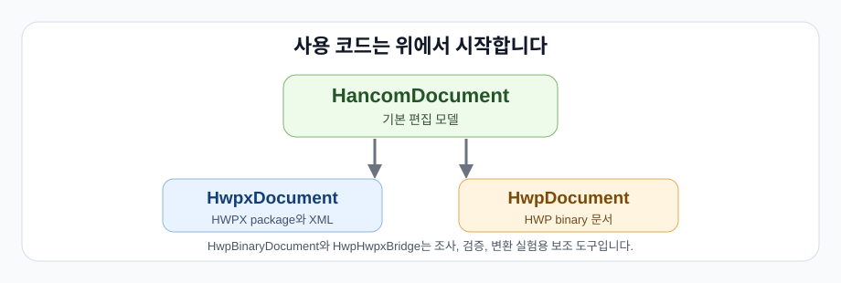

# jakal-hwpx

`jakal-hwpx` is a Python library for reading, editing, and writing `HWPX` and `HWP` documents,
with an optional beta addon for `DOCX` (Microsoft Word).

The package exposes a shared document API and format-specific implementations:

- `Document`: the shared document API (`HancomDocument` remains a compatibility alias)
- Beta DOCX addon `WordDocument(Document)`: retains Word details and dispatches shared edits to a Word backend
- `HwpxDocument`: direct HWPX package and XML editing
- `HwpDocument`: direct native HWP object and binary editing



## Installation

Requires Python 3.11 or newer.

```bash
python -m pip install --upgrade pip
python -m pip install jakal-hwpx
```

For local development:

```bash
python -m pip install -e ".[dev]"
```

Package name on PyPI is `jakal-hwpx`. Import path is `jakal_hwpx`.

## Quick start

For most application code, start with `Document`.

```python
from jakal_hwpx import Document

doc = Document.blank()
doc.metadata.title = "Quarterly report"
doc.append_paragraph("Sales summary")
doc.append_table(
    rows=2,
    cols=2,
    cell_texts=[["Item", "Value"], ["Q1", "120"]],
)

doc.write_to_hwpx("build/report.hwpx")
doc.write_to_hwp("build/report.hwp")
```

Reading an existing document uses the same model:

```python
from jakal_hwpx import Document

doc = Document.open("input.hwp")
doc.append_paragraph("Review complete")
doc.save("build/output.hwpx")
```

### DOCX addon (beta)

Install the current beta and its DOCX dependencies:

```bash
python -m pip install --upgrade --pre "jakal-hwpx[docx]"
```

Or install this checkout from the repository root:

```bash
python -m pip install -e ".[docx]"
```

The bundled addon lives in `jakal_hwpx.addons.docx` and shares the core library's
release. The default HWP/HWPX installation does not require python-docx; the addon
and its backend load only when requested. DOCX is a beta API in `1.1.0b1`;
behavior and fidelity may change before the stable `1.1.0` release.

#### Create a Word document

This example needs no input file. Output directories are created automatically.

```python
from jakal_hwpx.addons.docx import WordDocument

doc = WordDocument.blank()
doc.append_paragraph("Quarterly report")
doc.append_paragraph("Status: draft")
doc.append_table(
    rows=2,
    cols=2,
    cell_texts=[["Item", "Value"], ["Q1", "120"]],
)
doc.save("build/docx-example/original.docx")
```

#### Read, edit, and preserve Word details

Run this after the creation example, or replace the path with an existing DOCX.
`Document.open()` selects `WordDocument` automatically. An untouched DOCX save
preserves the original file byte for byte.

```python
from jakal_hwpx import Document
from jakal_hwpx.addons.docx import WordDocument
from docx.shared import Pt

doc = Document.open("build/docx-example/original.docx")
assert isinstance(doc, WordDocument)
doc.save("build/docx-example/untouched-copy.docx")

count = doc.replace_text("Status: draft", "Status: reviewed")
doc.append_paragraph("Review complete")

with doc.edit_word() as word:
    # `word` is the python-docx backend; changes refresh the common model on exit.
    for run in word.paragraphs[0].runs:
        run.bold = True
        run.font.size = Pt(18)

# Save after leaving edit_word() so native formatting changes are included.
doc.save("build/docx-example/edited.docx")
print(f"Replaced {count} occurrence(s)")
```

For positioned edits, text-range formatting, tables, pictures, and document stories,
use the transactional detail editor. Length arguments ending in `_pt` use points:

```python
with doc.edit_word_details() as edit:
    body = edit.body
    body.insert_paragraph(1, "Review notes")
    body.paragraph(1).format_text(bold=True, font_size_pt=14)
    body.table(0).set_cell_text(1, 1, "135")
    body.table(0).format(widths_pt=[240, 160], repeat_header=True)

doc.save("build/docx-example/detailed.docx")
```

Edits commit together or roll back on error. Handles expire when the context closes.
See the [Word detail editing guide](docs/word-editing.md) and run
`python examples/docx_editing.py` for an example with insertion, deletion, movement,
story edits, and optional picture editing.

Run `python examples/docx_advanced_editing.py` for a multi-page example covering
merged-table row/column edits, cell borders, page and column setup,
automatic lists, fields, and genuine footnotes. Add `--image path/to/image.png`
to include a picture. Both examples write DOCX, HWPX, and restored DOCX files.
Use `doc.append_paragraphs(texts)` to add many paragraphs with one model refresh.

For nested tables, repeating table headers, alternating page stories, a multi-paragraph
footnote, equations and landscape pages, run
`python examples/docx_complex_roundtrip.py --output-dir build/complex-word` (requires Pillow).
Export `source.docx` and `returned.docx` to PDF in the same Word installation, then compare
every page without resizing or aligning it:

```sh
python scripts/compare_document_pdfs.py build/complex-word/source.pdf build/complex-word/returned.pdf --output-dir build/complex-word/comparison
```

The comparison needs Pillow, numpy, pdfplumber and Poppler's `pdftoppm` on PATH
(or `--pdftoppm path/to/pdftoppm`). It writes per-page metrics, differences and a contact
sheet. White background does not count toward fidelity. Missing pages or different page
sizes invalidate the aggregate score. Four HWPX-origin forms/reports (14 pages) now
match every pixel after HWPX→DOCX→HWPX at 120dpi. The native path preserves the source
version, print settings and empty-run font metrics, and keeps technical Word properties
in a separate HWPX addon part so they do not change text justification. Hancom's own
HWPX SaveAs removes that addon part, so supplementary Word formatting and object IDs
stored only there are not guaranteed across that external resave. Some other complex
documents still have layout differences; see the dated results in the
[fidelity benchmark](docs/docx-fidelity-benchmark.md#2026-11-05-복잡한-문서의-양방향-왕복-검증).

To isolate body text, tables and editable equations from native drawings, pictures,
automatic numbers and page decorations, run:

```sh
python scripts/validate_hwpx_math_body.py examples/samples/hwpx/spacing_fix.hwpx --output-dir build/math-body
```

The original stays untouched. The tool writes an isolated `body-source.hwpx`,
`middle.docx`, `returned.hwpx`, `direct.hwpx` and `structure.json` with paragraph/equation
counts, body order and math structure checks. Export the isolated reference and result
in the same Hancom installation and compare their PDFs using the command above.
The structural report alone does not certify layout; see the
[body/math benchmark](docs/docx-fidelity-benchmark.md#수식본문-분리-검증).

#### Interact through stable object IDs

`WordEndpoint(doc)` exposes snapshots, document versions and atomic edits by UUID.
Keep those UUIDs on the client. Use `apply(..., compact=True)` and
`changes(version)` to receive only updated objects and deleted IDs;
`get_objects(ids)` reads selected objects without returning the whole document.
Literal hyperlink/field representation changes retain a uniquely matched logical link ID.

Word detail editing also supports structured field results (`field.edit_result()`),
content control creation and structural edits, and block moves between body/header/footer
with relationship remapping. `doc.update_fields()` explicitly refreshes supported fields;
`field.rebuild_toc()` rebuilds heading text and links while reporting pagination needs.
Additional native equations include cases, aligned stacks, binomials and barless fractions.
Run `python examples/docx_module_extensions.py` and see the
[editing guide](docs/word-editing.md#복합-필드-결과와-콘텐츠-컨트롤).
Inserting a paragraph does not change the IDs of existing paragraphs. Stale writes
raise `VersionConflict`; a failed batch rolls back all its edits. The optional HTTP
adapter uses the Python standard library:

```sh
python examples/word_endpoint.py
python examples/word_endpoint.py --serve --input input.docx --port 8765
```

The server prints its Bearer token. It provides `GET /document`, `GET /objects/{id}`,
`POST /edits`, and `GET /export.docx` / `GET /export.hwpx`. The demo covers rich
text ranges, bookmarks/links, style management, table split/join and native
matrix/summation/integral equations. See the [endpoint guide](docs/word-endpoint.md)
for request examples, ID persistence and external-editor limits.

#### Convert between DOCX, HWPX, and HWP

Run this after the editing example to convert DOCX to HWPX and back:

```python
from jakal_hwpx import Document

Document.open("build/docx-example/edited.docx").save("build/docx-example/converted.hwpx")
Document.open("build/docx-example/converted.hwpx").save("build/docx-example/restored.docx")
```

For your own documents, choose the output format by its extension:

```python
from jakal_hwpx import Document

Document.open("input.docx").save("build/from_word.hwpx")
Document.open("input.docx").save("build/from_word.hwp")
Document.open("input.hwpx").save("build/from_hwpx.docx")
Document.open("input.hwp").save("build/from_hwp.docx")

# Obtain an editable WordDocument before saving, if needed.
word = Document.open("input.hwpx").to_docx_document()
with word.edit_word() as backend:
    backend.add_paragraph("Added in Word")
word.save("build/from_hwpx_edited.docx")
```

#### Run the complete example

From the repository root, after installing `.[docx]`:

```bash
python examples/docx_addon.py
# Optional: choose a different output directory.
python examples/docx_addon.py --output-dir build/my-word-demo
```

The [runnable example](examples/docx_addon.py) creates `original.docx`,
`untouched-copy.docx`, `edited.docx`, `converted.hwpx`, and `restored.docx` in
`build/docx-example/` by default. It checks the untouched copy's bytes and prints
each output path. Microsoft Word and Hancom Office are not required to run it.

Shared DOCX edits preserve unrelated package parts. Cross-format conversion maps
supported content and formatting through the common model; it does not guarantee
identical layout or preservation of every Word feature. Unsupported Word features
produce `UserWarning` messages during conversion. The addon preserves independent
body reference and footnote/endnote marker formatting. It maps picture placement,
crop/rotation, conditional table formatting, theme colors, spacing, and baseline
offsets to HWPX, and restores Word content controls and custom XML bindings on return.
Word text boxes become editable Hancom text shapes. Nested and multi-paragraph
fields retain their visible results and Word field structure on return.
Supported lists use native Hancom counters; page counts, date/summary fields,
bookmark references, and compatible table formulas use native automatic controls.
Word commands and additional properties survive the return to DOCX. First-page
headers/footers use fixed text boxes in HWPX. Advanced list formats and fields
without a native mapping retain their displayed values and emit a warning.
HWP has additional limits; an external converter remains opt-in.

The existing `from jakal_hwpx import WordDocument` import remains supported.
The low-level `HwpxDocument` and `HwpDocument` classes also provide
`save_as_docx()` and `to_docx_document()`. Equation conversion supports a subset of
OMML/Hancom math; other structures and embedded objects have limits.
See the [DOCX addon guide](docs/docx-addon.md),
[WordDocument API and export limits](docs/word-document.md), and
[formatting and foreground-render verification](docs/docx-fidelity-benchmark.md).

## Direct HWPX authoring

Use `HwpxDocument` when you want explicit control over paragraphs, runs, controls, package parts, or validation.

```python
from jakal_hwpx import HwpxDocument

doc = HwpxDocument.blank()
doc.append_paragraph("Inline math:")
doc.append_inline("equ", "x+y", width=3200, height=1800)
doc.append_inline("text", " = z")
doc.append_block("equ", "a+b", width=2800, height=1700)

doc.strict_validate()
doc.save("build/direct.hwpx")
```

There are now two authoring styles for controls:

- `append_block(kind=..., content=..., **kwargs)`: insert a block-level control
- `append_inline(kind=..., content=..., **kwargs)`: reuse the target paragraph instead of creating a new one

Examples:

```python
doc.append("equ", "x+y")
doc.append_inline("equ", "x+y")
doc.append_inline("text", " + z")
doc.append_block("table", [["A", "B"], ["1", "2"]])
```

Supported type aliases include:

- `text`, `paragraph`
- `eq`, `equ`, `equation`
- `pic`, `image`, `picture`
- `table`, `tbl`
- `bookmark`, `field`, `hyperlink`
- `note`, `footnote`, `endnote`
- `form`, `memo`, `chart`, `ole`, `shape`
- `autonum`, `newnum`
- `header`, `footer`

The older explicit APIs still exist and remain the lowest-level stable surface:

- `append_equation()`
- `append_inline_equation()`
- `append_picture()`
- `append_shape()`
- `append_ole()`
- `append_table()`

## Choosing the right layer

| Layer | Use it for |
|---|---|
| `Document` | format-neutral authoring, conversion, block-level editing |
| `WordDocument` (DOCX addon, beta) | Word package preservation, shared edits, and python-docx formatting |
| `HwpxDocument` | direct HWPX package editing, XML placement, validation, control surgery |
| `HwpDocument` | direct native HWP object editing and low-level HWP inspection |
| `HwpBinaryDocument` | record tree, streams, DocInfo, and section model inspection |

Additional public API documentation lives in [HWPX_MODULE.md](https://github.com/Ahnd6474/jakal-hwpx/blob/main/HWPX_MODULE.md).

## Validation and release checks

Basic test run:

```bash
python -m pytest tests/test_document_model.py tests/test_hancom_document.py -q
```

Packaging and release validation:

```bash
python -m build
python -m twine check dist/*
python scripts/check_release.py --profile ci
```

On the Windows release machine, run the full Hancom gate as well:

```powershell
python scripts/check_release.py --profile release
```

## Documentation

- [HWPX_MODULE.md](https://github.com/Ahnd6474/jakal-hwpx/blob/main/HWPX_MODULE.md): public module and API index
- [docs/README.md](https://github.com/Ahnd6474/jakal-hwpx/blob/main/docs/README.md): docs directory index
- [docs/hancom-document.md](https://github.com/Ahnd6474/jakal-hwpx/blob/main/docs/hancom-document.md): `Document`
- [docs/docx-addon.md](docs/docx-addon.md): DOCX addon installation and architecture
- [docs/word-document.md](docs/word-document.md): `WordDocument`, Word editing, and conversion limits
- [examples/docx_addon.py](examples/docx_addon.py): runnable DOCX creation, editing, and HWPX round trip
- [docs/hwpx-document.md](https://github.com/Ahnd6474/jakal-hwpx/blob/main/docs/hwpx-document.md): `HwpxDocument`
- [docs/hwp-document.md](https://github.com/Ahnd6474/jakal-hwpx/blob/main/docs/hwp-document.md): `HwpDocument`
- [docs/bridge-and-binary.md](https://github.com/Ahnd6474/jakal-hwpx/blob/main/docs/bridge-and-binary.md): bridge and binary internals
- [RELEASING.md](https://github.com/Ahnd6474/jakal-hwpx/blob/main/RELEASING.md): release checklist

## License

Released under the [MIT License](https://github.com/Ahnd6474/jakal-hwpx/blob/main/LICENSE).
